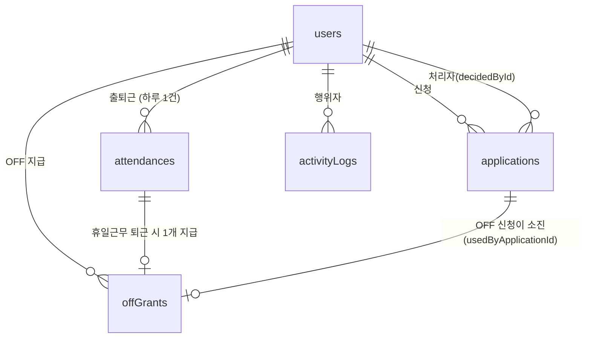

# 데이터 모델 (JSON 저장소)

[← README로 돌아가기](../README.md)

이 프로젝트는 데이터베이스 서버 없이 **로컬 JSON 파일**에 저장합니다. 이 문서는 파일 구조, 컬렉션(테이블)별 필드, 관계, 그리고 그렇게 설계한 이유를 설명합니다.

## 1. 저장 방식

| 파일 | 내용 |
| --- | --- |
| `backend/data/db.json` | `users`, `allowedIps`, `holidays`, `attendances`, `applications`, `offGrants` |
| `backend/data/activity-log.jsonl` | `activityLogs` (계속 쌓이는 이력). JSON Lines: 한 줄에 한 건 |

```
서버 시작:  파일 읽기 → 메모리 Table 에 적재   (파일이 없으면 초기 데이터 생성)
요청 처리:  메모리에서 조회·수정(동기)  →  await store.commit()
commit():   바뀐 파일만 임시 파일(.tmp)에 쓰고 → 이름 변경(rename)  (저장 중 끊겨도 기존 파일 보존)
```

- `commit()`은 한 번에 하나씩 순서대로 실행되는 큐를 거칩니다.
- 파일이 JSON으로 읽히지 않으면 **덮어쓰지 않고** 오류로 시작을 멈춥니다(손으로 고치다 생긴 오타로 데이터를 잃지 않도록).
- 손으로 추가한 레코드에 `id`가 없으면 다음 시작 때 자동으로 채웁니다.
- 위치는 `DATA_DIR`로 바꿀 수 있고, 폴더를 지우면 처음 상태(초기 데이터)로 돌아갑니다.

## 2. 관계도



- 연결은 모두 **숫자 id 참조**입니다. 외래 키 제약은 DB가 걸어주지 않으므로 서비스 코드가 보장합니다(예: 신청을 만들 때 `userId`는 로그인한 사용자).
- `holidays`와 `allowedIps`는 다른 레코드와 연결되지 않는 **참조 데이터**입니다. 공휴일은 영업일·신청 기한 판정에, 연구실 IP는 접속 허용 판정에 날짜·주소 값으로만 쓰입니다.

## 3. 컬렉션별 필드

날짜는 `'YYYY-MM-DD'`(KST), 시각은 ISO 8601(UTC) 문자열입니다. `?`는 `null` 가능.

### users
| 필드 | 설명 |
| --- | --- |
| `id` | 자동 증가 |
| `loginId` | 로그인 아이디(유일) |
| `passwordHash` | `scrypt$…` 해시. 평문은 저장하지 않음 |
| `name` | 표시 이름 |
| `role` | `MEMBER`(팀원) / `LEAD`(리드) |
| `hireDate` | 입사일. **연차 적립의 기준** |
| `createdAt` | 생성 시각 |

### allowedIps
| 필드 | 설명 |
| --- | --- |
| `id`, `ip` | 연구실 IP(IPv4/IPv6, 정규화해서 저장·비교, 유일) |
| `label?` | 이름(예: 본관 2층) |

### holidays
| 필드 | 설명 |
| --- | --- |
| `id`, `date`, `name` | 공휴일 날짜(유일)와 이름. 영업일 판정·신청 기한 계산에 사용 |

### attendances (사용자 1명당 하루 1건)
| 필드 | 설명 |
| --- | --- |
| `userId`, `workDate` | 누구의 어느 날 기록인지 (조합이 유일) |
| `workType` | `OFFICE` / `REMOTE` / `WEEKEND_WORK` |
| `clockIn`, `clockInIp` | 출근 시각·IP |
| `clockOut?`, `clockOutIp?` | 퇴근 시각·IP (`null`이면 아직 퇴근 전 또는 퇴근 누락) |
| `clockOutManual` | 퇴근을 찍지 않아 다음 출근 때 **직접 입력**한 경우 `true` |
| `isLate`, `isEarlyLeave` | 지각 / 조퇴 판정 결과 |
| `workMinutes?` | 근무시간(분). 점심 1시간 제외 반영 |

### applications
| 필드 | 설명 |
| --- | --- |
| `userId`, `type`, `targetDate`, `reason?` | 신청자·종류(`ANNUAL`/`REMOTE`/`OFF`/`WEEKEND_WORK`)·대상일·사유 |
| `ip?`, `startTime?`, `endTime?` | **재택·휴일근무만** 사용. 이 IP와 시간대(`HH:mm`)에서만 접속 허용 |
| `status` | `PENDING` / `APPROVED` / `REJECTED` / `CANCELLED` |
| `decidedById?`, `decidedAt?`, `decisionNote?` | 리드의 승인·반려 기록 |
| `createdAt` | 제출 시각 |

`PENDING`과 `APPROVED`는 모두 **유효**한 신청입니다(제출 즉시 효력). `REJECTED`와 `CANCELLED`는 무효이며 소진한 잔여가 돌아옵니다.

### offGrants (반일 OFF, 지급 1건 = 1행)
| 필드 | 설명 |
| --- | --- |
| `userId` | 소유자 |
| `attendanceId` | 어떤 휴일근무 기록 때문에 지급됐는지 |
| `grantedDate`, `expiresDate` | 지급일, 만료일(지급일 + 30일) |
| `usedByApplicationId?` | 이 OFF를 소진한 신청. `null`이면 미사용 |

### activityLogs (별도 파일)
| 필드 | 설명 |
| --- | --- |
| `userId?` | 행위자(로그인 실패처럼 사용자를 알 수 없으면 `null`) |
| `action` | `LOGIN`, `CLOCK_IN`, `APPLICATION_CREATE`, `IP_ADD` … |
| `ip?`, `createdAt` | 접속 IP, 시각 |
| `detail?` | 동작별 부가 정보(JSON) |

## 4. 설계 이유

### 왜 JSON 파일인가
처음에는 MySQL + Prisma로 설계·구현했습니다. 하지만 이 프로젝트는 **"로컬에서 바로 실행하고 테스트할 수 있어야 한다"**는 요구가 있고, DB 서버 설치·계정·마이그레이션 단계가 이를 가로막았습니다. 팀 단위(수십 명, 연 수천 건)의 규모에서는 파일 저장소로 충분하다고 판단해 전환했습니다.

- 클론 후 `npm install`만 하면 실행·테스트 가능(외부 프로세스 없음)
- 테스트가 임시 폴더만 바꿔서 완전히 격리됨
- 데이터가 눈에 보이고 백업은 폴더 복사

필드 구성은 관계형 모델과 같게 유지했습니다(id 참조, 컬렉션 = 테이블). 규모가 커져 DB가 필요해지면 `DataStore`/`Table`만 교체하면 되도록 서비스는 `find/filter/insert/update/remove`로만 접근합니다.

### 잔여는 저장하지 않고 계산한다
연차·재택 잔여를 숫자 컬럼으로 두지 않고 `hireDate`와 유효한 신청 목록에서 **그때그때 계산**합니다(`rules/balance.rules.ts`).

- 신청·취소·반려가 있을 때마다 잔여 숫자를 맞춰 줘야 하는 이중 기록이 없어 불일치가 생길 수 없음
- 월말 정산처럼 "특정 시점 기준 잔여"도 같은 함수로 계산 가능

### OFF는 지급 1건을 1행으로 둔다
OFF는 지급일마다 만료일이 달라서 숫자 하나로는 관리할 수 없습니다. 지급 1건 = 1행으로 두면 다음이 자연스럽습니다.

- 만료가 가장 빠른 지급분부터 소진
- 취소·반려하면 `usedByApplicationId`를 `null`로 되돌려 반환
- 어떤 휴일근무(`attendanceId`)로 받았는지 추적

### 판정 결과를 기록에 남긴다
`attendances`에 `isLate`, `isEarlyLeave`, `workMinutes`를 저장합니다. 계산할 수 있는 값이지만, **그날의 판정을 기록으로 보존**해 정산이 단순해지고, 나중에 규칙이 바뀌어도 이미 확정된 기록이 달라지지 않습니다. 이 값들은 오직 서버의 출퇴근 처리에서만 계산됩니다.

### 날짜·시각을 문자열로 저장한다
- 날짜 `'YYYY-MM-DD'`: 시간대 변환 없이 "며칠인지"만 필요한 값(대상일·근무일·입사일)을 `Date`로 두면 UTC/KST 경계에서 하루가 밀리는 오류가 생깁니다.
- 시각 ISO 문자열: 절대 시각을 그대로 보존하고, JSON에 바로 들어갑니다.
- 둘 다 **문자열 비교가 곧 시간 비교**라서 기간 조회(`>=`, `<=`)가 단순합니다.

### 이력을 별도 파일로 분리한다
이력은 계속 추가만 되고 개수가 가장 빠르게 늘어납니다. 업무 데이터와 같은 파일에 두면 출퇴근 한 번에 이력 전체를 다시 써야 하므로 분리했습니다. 반대로 `db.json`의 여섯 컬렉션은 신청 + OFF 연결처럼 **함께 바뀌어야** 하는 값이 있어 한 파일을 한 번에 원자적으로 교체합니다.

### 이력은 JSON Lines로 덧붙인다
처음에는 이력도 JSON 배열 한 덩어리였지만, 그러면 이력 한 건을 남길 때마다 지금까지의 이력 전체를 다시 써야 했습니다(요청 하나가 `db.json`과 이력 파일 전체를 연달아 쓰는 셈). 지금은 한 줄에 한 건(JSON Lines)으로 두고 **새 줄만 파일 끝에 덧붙입니다.**

- 이력은 수정·삭제하지 않는 추가 전용이라 "메모리에서 이미 저장한 개수 뒤의 것만 덧붙이기"로 충분합니다.
- **복구**: 쓰는 도중 서버가 꺼져 *마지막 줄만* 잘렸다면 그 줄을 버리고 파일을 깨끗하게 다시 씁니다. *중간 줄*이 깨졌다면 데이터를 잃지 않도록 줄 번호와 함께 시작을 멈춥니다.
- 덧붙이기 자체가 실패하면 파일이 어중간할 수 있으니 다음 저장 때 전체를 임시 파일에 써서 교체합니다.
- **이전**: 예전 `activity-log.json`(배열)이 있으면 첫 시작 때 `.jsonl`로 옮기고 원본은 `activity-log.json.bak`으로 남깁니다(이전 후에도 내용이 같음을 e2e 테스트가 확인합니다).
- 시작할 때는 여전히 파일 전체를 읽어 메모리에 올립니다.

### 제약은 코드로 보장한다
| 제약 | 보장 위치 |
| --- | --- |
| `loginId` 유일 | 초기 데이터 생성 |
| 하루 출근 1회 | `AttendanceService.clockIn`이 `workDate`로 중복 검사 |
| 같은 날짜에 유효한 신청 1건 | `ApplicationService.create`의 `DUPLICATE` |
| IP·공휴일 날짜 유일 | `allowedIps` 컨트롤러 / `HolidayService.upsert` |
| 사용자 존재 | 로그인한 사용자 id만 사용 |

## 5. 한계와 주의

- **프로세스 1개**: 여러 프로세스가 같은 폴더를 쓰면 서로의 변경을 덮어씁니다. 검사→변경이 끼어들지 않는다는 보장도 단일 프로세스에서만 성립합니다.
- **전체 파일 다시 쓰기**: 업무 데이터는 변경이 있을 때마다 `db.json` 전체를 씁니다(이력은 덧붙이기). 데이터가 수십 MB 수준으로 커지면 느려집니다.
- **저장 실패 시 되돌리지 않음**: 메모리를 먼저 바꾸고 파일에 저장하므로, 저장이 실패하면 요청은 오류를 받지만 메모리의 변경은 남아 다음 저장 때 함께 기록됩니다(롤백 없음).
- **id 재사용**: 다음 id는 시작할 때 `최댓값 + 1`로 계산하므로, 마지막 행을 지우고 재시작하면 같은 id가 다시 나올 수 있습니다.
- **인덱스·쿼리 없음**: 조회는 메모리 선형 탐색입니다. 팀 규모에서는 문제가 없습니다.
- **마이그레이션 도구 없음**: 필드를 바꾸면 기존 파일을 직접 변환해야 합니다.
- **직접 수정**: 서버를 끈 상태에서만 고치세요. 켜 둔 채 고치면 다음 저장 때 덮어써집니다.
