# 시퀀스 다이어그램

근태관리 시스템의 **기능별 시퀀스 다이어그램**입니다. 기능마다 Mermaid 코드로 흐름을 그리고, 이미지(PNG)로 렌더링해 모았습니다. 코드는 실제 소스를 읽고 작성했으며, 분기마다 응답 코드(`400 TOO_EARLY` 등)를 함께 적었습니다.

> 관련 문서: [README](../README.md) · [architecture.md](architecture.md) (구조) · [api.md](api.md) (API·오류 코드) · [database.md](database.md) (데이터)

## 목차

**A. 인증·접속 제어**

| 번호 | 기능 | 요구사항 | API | 권한 |
| --- | --- | --- | --- | --- |
| [01](#seq-01) | 로그인 | FN-SYS-02 | `POST /api/auth/login`, `GET /api/auth/me` | 누구나 (공개 API) |
| [02](#seq-02) | 로그인 시도 제한 | 보안 요구 | `POST /api/auth/login` 내부 | 누구나 (공개 API) |
| [03](#seq-03) | 접속 IP·시간대·권한 검사 (모든 요청) | FN-SYS-01 | 로그인·상태 확인을 뺀 **모든 API** | 로그인한 사용자 (전역 가드 통과) |
| [04](#seq-04) | 로그인 상태 복원과 화면 이동 | 화면 접근 제어 | `GET /api/auth/me` | 누구나 |

**B. 출퇴근**

| 번호 | 기능 | 요구사항 | API | 권한 |
| --- | --- | --- | --- | --- |
| [05](#seq-05) | 출근 | FN-ATT-01, FN-ATT-04 | `POST /api/attendance/clock-in` | 로그인한 사용자 (전역 가드 통과) |
| [06](#seq-06) | 퇴근 | FN-ATT-02, FN-ATT-04 | `POST /api/attendance/clock-out` | 로그인한 사용자 (전역 가드 통과) |
| [07](#seq-07) | 퇴근 직접 입력과 출근 재시도 | FN-ATT-03 | `POST /api/attendance/manual-clock-out` | 로그인한 사용자 (전역 가드 통과) |
| [08](#seq-08) | 월별 출퇴근 기록 조회 | 출퇴근 조회 | `GET /api/attendance?month&userId` | 본인 (리드는 팀원 지정 가능) |

**C. 대시보드**

| 번호 | 기능 | 요구사항 | API | 권한 |
| --- | --- | --- | --- | --- |
| [09](#seq-09) | 내 대시보드 카드 | FN-DSH-02 | `GET /api/dashboard/me` | 로그인한 사용자 (전역 가드 통과) |
| [10](#seq-10) | 팀 보드 | FN-DSH-01 | `GET /api/dashboard/team` | 리드 |
| [11](#seq-11) | 미기록 건 조회 | FN-DSH-03 | `GET /api/dashboard/issues` | 본인 (리드는 팀 전체 가능) |

**D. 신청 (연차·재택·OFF·주말근무)**

| 번호 | 기능 | 요구사항 | API | 권한 |
| --- | --- | --- | --- | --- |
| [12](#seq-12) | 신청서 제출 | FN-REQ-01 | `POST /api/applications` | 로그인한 사용자 (전역 가드 통과) |
| [13](#seq-13) | 신청 목록 조회 | 신청 조회 | `GET /api/applications` | 본인 (팀 신청은 리드) |
| [14](#seq-14) | 신청 취소 | 신청 취소 | `POST /api/applications/:id/cancel` | 신청한 본인 |
| [15](#seq-15) | 신청 승인·반려 | FN-REQ-02 | `POST /api/applications/:id/approve`, `.../reject` | 리드 |
| [16](#seq-16) | 신청서 PDF 다운로드 | FN-REQ-03 | `GET /api/applications/:id/pdf` | 신청한 본인 또는 리드 |
| [17](#seq-17) | 내 연차·재택·OFF 잔여 조회 | FN-BAL-01 | `GET /api/balances/me` | 로그인한 사용자 (전역 가드 통과) |

**E. 정산·이력**

| 번호 | 기능 | 요구사항 | API | 권한 |
| --- | --- | --- | --- | --- |
| [18](#seq-18) | 월별 정산 | FN-STL-01 | `GET /api/settlement?month=YYYY-MM` | 본인 행 (리드는 팀 전체) |
| [19](#seq-19) | 이력 조회 | FR-LOG-01 | `GET /api/logs` | 본인 이력 (리드는 전체) |

**F. 리드 관리 (공휴일·접속 IP)**

| 번호 | 기능 | 요구사항 | API | 권한 |
| --- | --- | --- | --- | --- |
| [20](#seq-20) | 공휴일 조회 | 공휴일 관리 | `GET /api/holidays?year` | 로그인한 사용자 (화면은 리드 전용) |
| [21](#seq-21) | 공휴일 등록·삭제 | 공휴일 관리 | `POST /api/holidays`, `DELETE /api/holidays/:date` | 리드 |
| [22](#seq-22) | 연구실 접속 IP 목록 조회 | IP 관리 | `GET /api/allowed-ips` | 리드 |
| [23](#seq-23) | 연구실 접속 IP 등록 | IP 관리 | `POST /api/allowed-ips` | 리드 |
| [24](#seq-24) | 연구실 접속 IP 이름 수정 | IP 관리 | `PATCH /api/allowed-ips/:id` | 리드 |
| [25](#seq-25) | 연구실 접속 IP 삭제 | IP 관리 | `DELETE /api/allowed-ips/:id` | 리드 |

**G. 공통·운영**

| 번호 | 기능 | 요구사항 | API | 권한 |
| --- | --- | --- | --- | --- |
| [26](#seq-26) | 데이터 저장과 이력 기록 | 데이터 저장 (공통) | 모든 쓰기 기능 내부 | — |
| [27](#seq-27) | 서버 상태 확인 | 운영 | `GET /api/health` | 누구나 (공개 API) |

## 읽는 방법

**참여자**

| 이름 | 역할 |
| --- | --- |
| 사용자 / 리드 | 화면을 쓰는 사람. 역할은 팀원(MEMBER)과 리드(LEAD) |
| 화면 (…View) | 프론트엔드(Vue). `fetch`로 API를 호출하고 결과를 그린다 |
| AccessGuard | 모든 요청이 먼저 거치는 전역 가드 (03번) |
| …Controller | 요청 경로·입력 형식 검사(DTO)·권한(`@Roles`)만 담당하고 서비스에 위임 |
| …Service | 업무 규칙(기한, 잔여, 중복 등)을 검사하고 데이터를 바꾼다 |
| DataStore | 메모리 컬렉션 + JSON 파일 저장 (`commit()`, 26번) |
| ActivityLog | 이력 기록 (`APPLICATION_CREATE` 같은 행동 이름으로 남긴다, 26번) |

**표기**

- `break [조건]` 상자: 그 조건이면 **거기서 요청이 끝나고** 오류 응답을 돌려준다는 뜻입니다. 위에서 아래로 읽으면 검사 순서가 됩니다.
- `alt` / `else`: 경우에 따라 갈라지는 흐름, `opt`: 조건이 맞을 때만 일어나는 단계, `loop`: 반복, `par`: 동시에 요청.
- 실선 화살표는 호출·요청, 점선 화살표는 응답입니다. 노란 상자는 보충 설명입니다.
- 03번을 뺀 기능 다이어그램은 맨 위에 "전역 AccessGuard를 통과한 뒤 실행"이라고 적혀 있으며, 가드 단계는 생략했습니다. 리드 전용 API를 팀원이 호출하면 가드가 `403 FORBIDDEN`으로 막습니다.
- 다이어그램 안의 "NN번"은 이 문서의 해당 번호를 가리킵니다.

---

## A. 인증·접속 제어

<a id="seq-01"></a>

### 01. 로그인

아이디·비밀번호를 확인하고, 접속 IP·시간대를 검사한 뒤 토큰(JWT)을 발급합니다. 로그인 성공 직후 `/auth/me`로 내 정보와 접속 IP를 가져옵니다.

- **요구사항**: FN-SYS-02
- **API**: `POST /api/auth/login`, `GET /api/auth/me`
- **권한**: 누구나 (공개 API)
- **소스**: `backend/src/auth/auth.service.ts`, `frontend/src/views/LoginView.vue`, `frontend/src/stores/auth.ts`

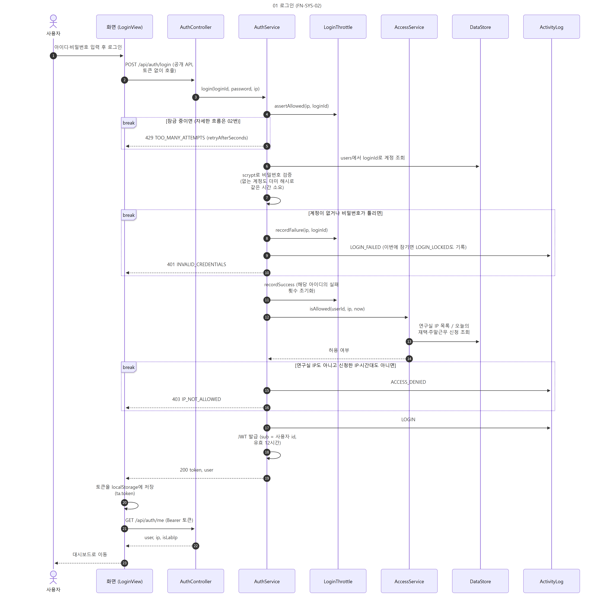

<details>
<summary>Mermaid 코드 보기</summary>

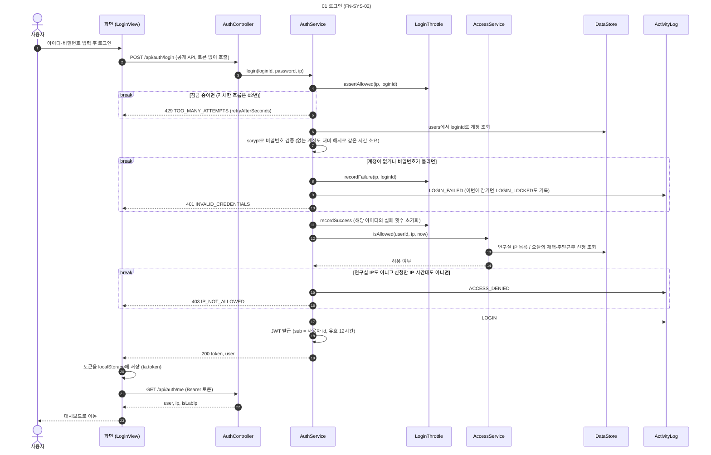

</details>

[↑ 목차](#목차)

<a id="seq-02"></a>

### 02. 로그인 시도 제한

같은 IP·아이디로 10분 안에 5번 틀리면 10분간 잠그고(429), 한 IP 전체로는 20번까지만 허용합니다. 잠금 여부는 비밀번호 검증(scrypt) 전에 확인합니다.

- **요구사항**: 보안 요구
- **API**: `POST /api/auth/login` 내부
- **권한**: 누구나 (공개 API)
- **소스**: `backend/src/core/login-throttle.service.ts`

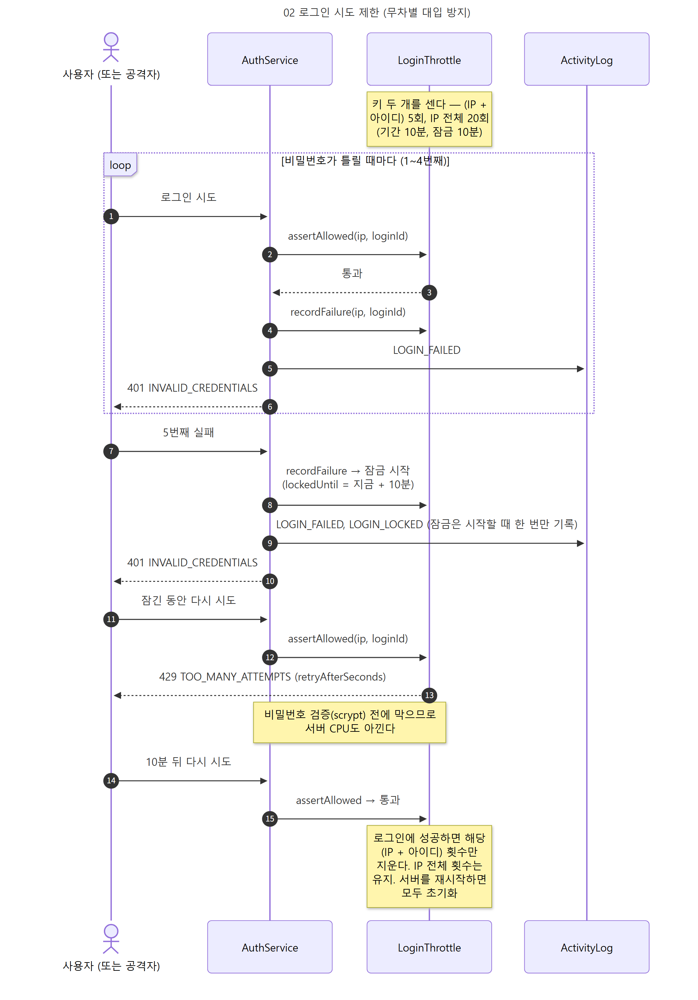

<details>
<summary>Mermaid 코드 보기</summary>

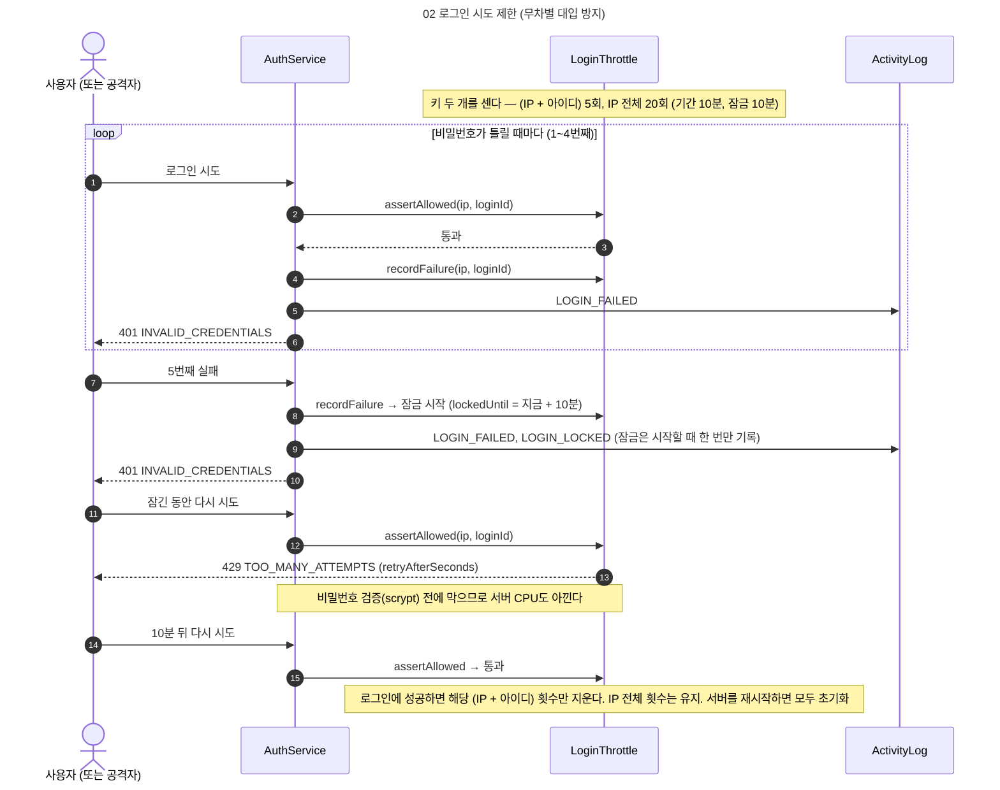

</details>

[↑ 목차](#목차)

<a id="seq-03"></a>

### 03. 접속 IP·시간대·권한 검사 (모든 요청)

모든 요청이 컨트롤러에 닿기 전에 거치는 전역 가드입니다. 토큰 → 사용자 → 접속 IP·시간대 → 역할 순서로 확인하며, 연구실 IP는 상시 허용, 재택·주말근무는 신청한 IP·시간대에서만 허용합니다. 아래 기능 다이어그램은 이 단계를 통과한 뒤의 흐름입니다.

- **요구사항**: FN-SYS-01
- **API**: 로그인·상태 확인을 뺀 **모든 API**
- **권한**: 로그인한 사용자 (전역 가드 통과)
- **소스**: `backend/src/auth/access.guard.ts`, `backend/src/core/access.service.ts`, `frontend/src/api/client.ts`, `frontend/src/App.vue`

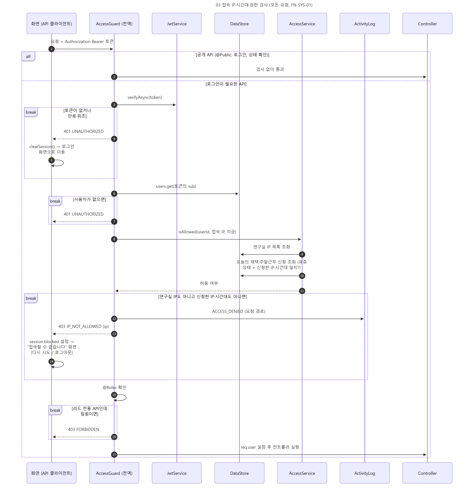

<details>
<summary>Mermaid 코드 보기</summary>

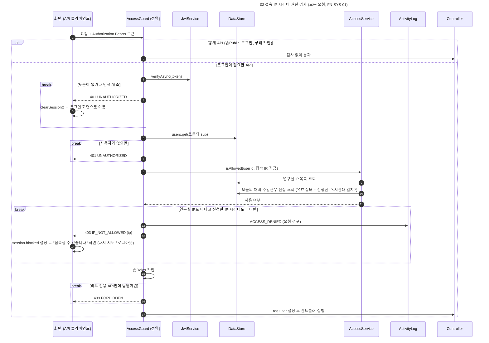

</details>

[↑ 목차](#목차)

<a id="seq-04"></a>

### 04. 로그인 상태 복원과 화면 이동

새로고침해도 저장된 토큰으로 로그인 상태를 되살리고, 로그인 여부와 역할(리드 전용 화면)에 따라 이동할 화면을 정합니다.

- **요구사항**: 화면 접근 제어
- **API**: `GET /api/auth/me`
- **권한**: 누구나
- **소스**: `frontend/src/router.ts`, `frontend/src/stores/auth.ts`, `frontend/src/stores/session.ts`

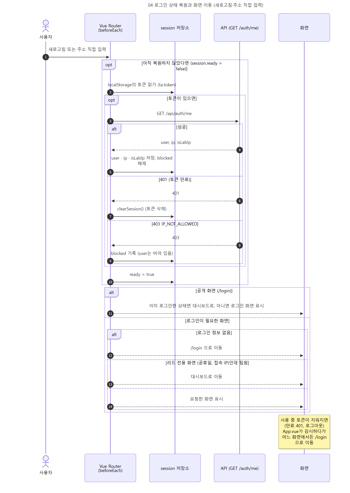

<details>
<summary>Mermaid 코드 보기</summary>

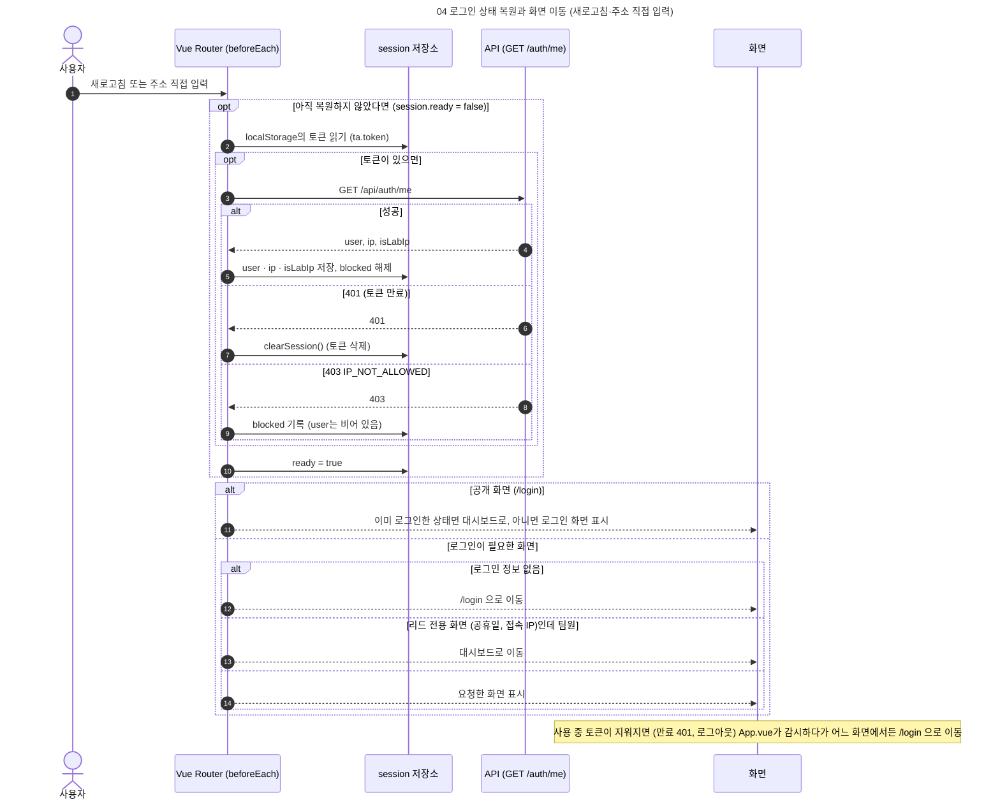

</details>

[↑ 목차](#목차)

## B. 출퇴근

<a id="seq-05"></a>

### 05. 출근

07:00부터 출근할 수 있고 10:00:00을 넘기면 지각입니다. 지난 날 퇴근이 비어 있으면 막히고, 주말·공휴일은 신청한 날짜·시간대·IP에서만 출근할 수 있습니다.

- **요구사항**: FN-ATT-01, FN-ATT-04
- **API**: `POST /api/attendance/clock-in`
- **권한**: 로그인한 사용자 (전역 가드 통과)
- **소스**: `backend/src/attendance/attendance.service.ts`, `backend/src/rules/attendance.rules.ts`

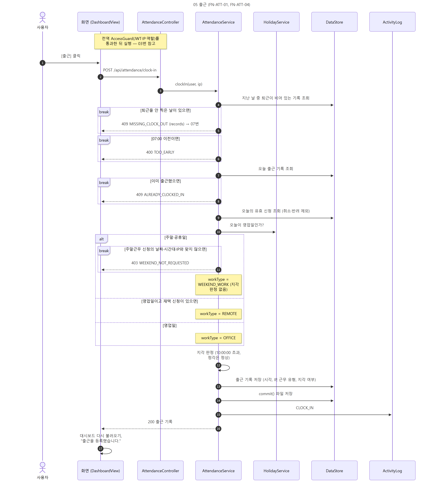

<details>
<summary>Mermaid 코드 보기</summary>

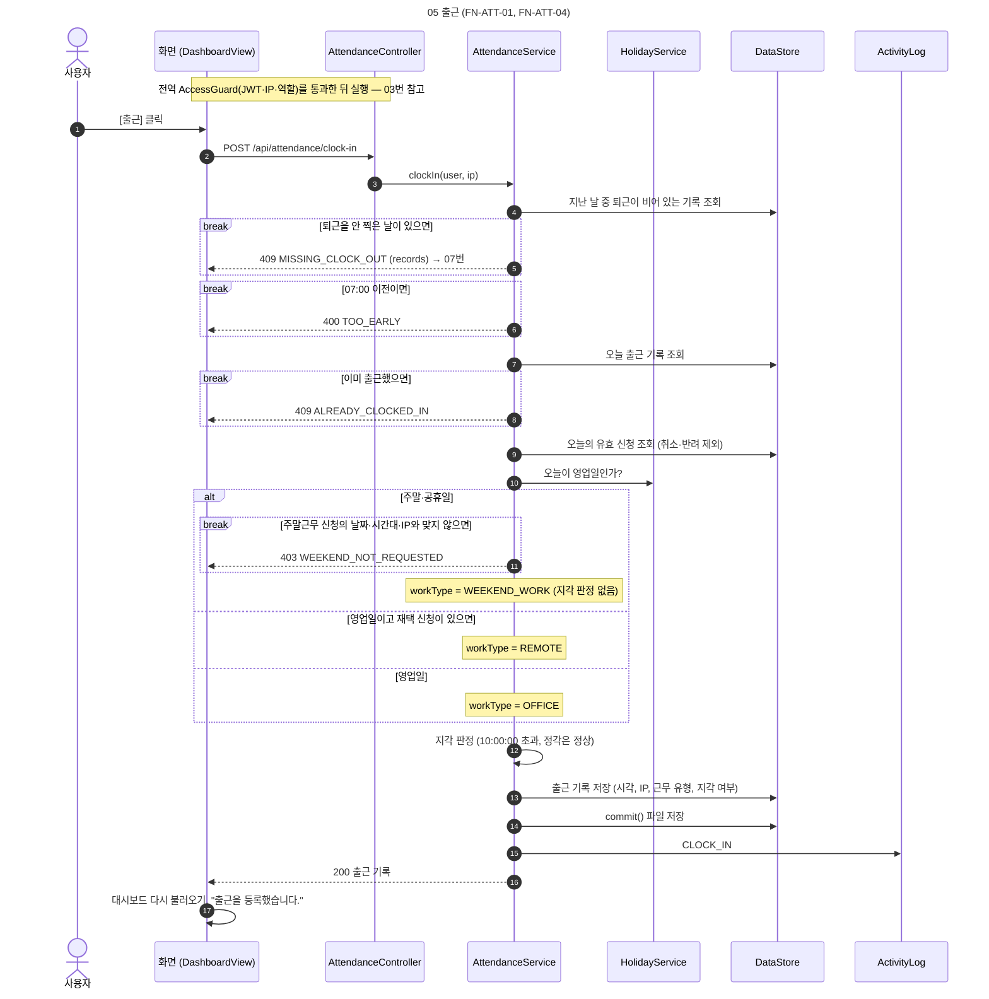

</details>

[↑ 목차](#목차)

<a id="seq-06"></a>

### 06. 퇴근

16:00부터 퇴근할 수 있습니다(반일 OFF 사용일은 제외). 점심은 11:30~12:30이 전부 근무 구간에 들어올 때만 1시간 차감하고, 8시간 미만이면 조퇴입니다. 휴일 근무는 반일 OFF를 지급합니다.

- **요구사항**: FN-ATT-02, FN-ATT-04
- **API**: `POST /api/attendance/clock-out`
- **권한**: 로그인한 사용자 (전역 가드 통과)
- **소스**: `backend/src/attendance/attendance.service.ts`, `backend/src/rules/attendance.rules.ts`

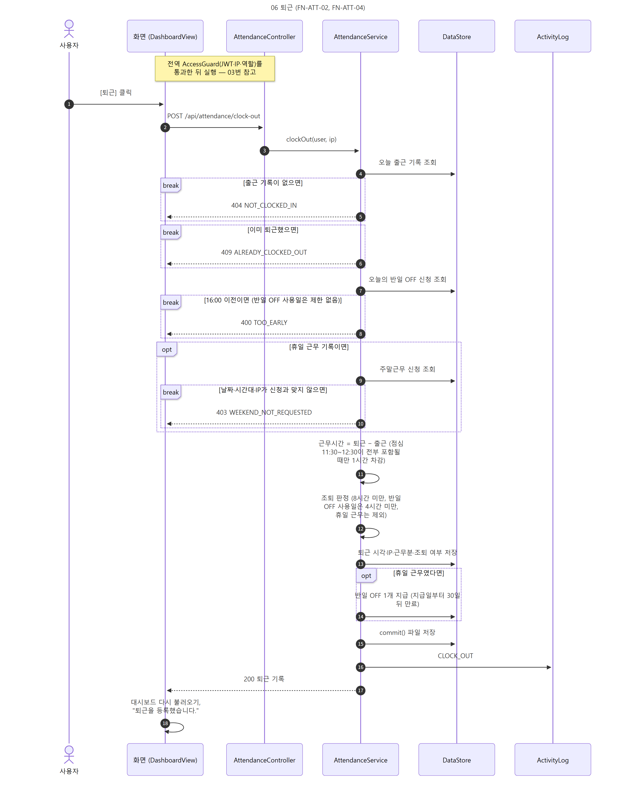

<details>
<summary>Mermaid 코드 보기</summary>

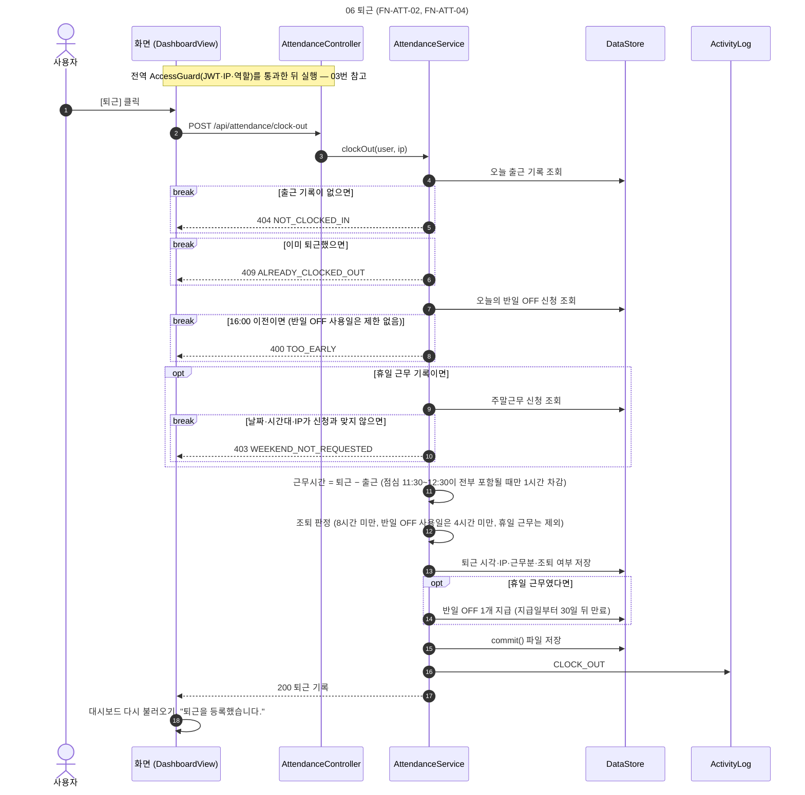

</details>

[↑ 목차](#목차)

<a id="seq-07"></a>

### 07. 퇴근 직접 입력과 출근 재시도

퇴근을 찍지 않은 날이 있으면 출근이 거절되고(409), 직접 입력 창에서 퇴근 시각을 채운 뒤 출근을 자동으로 다시 시도합니다. 지난 날의 기록만 입력할 수 있고 "직접 입력"으로 표시됩니다.

- **요구사항**: FN-ATT-03
- **API**: `POST /api/attendance/manual-clock-out`
- **권한**: 로그인한 사용자 (전역 가드 통과)
- **소스**: `backend/src/attendance/attendance.service.ts`, `frontend/src/components/ManualClockOutModal.vue`, `frontend/src/views/DashboardView.vue`

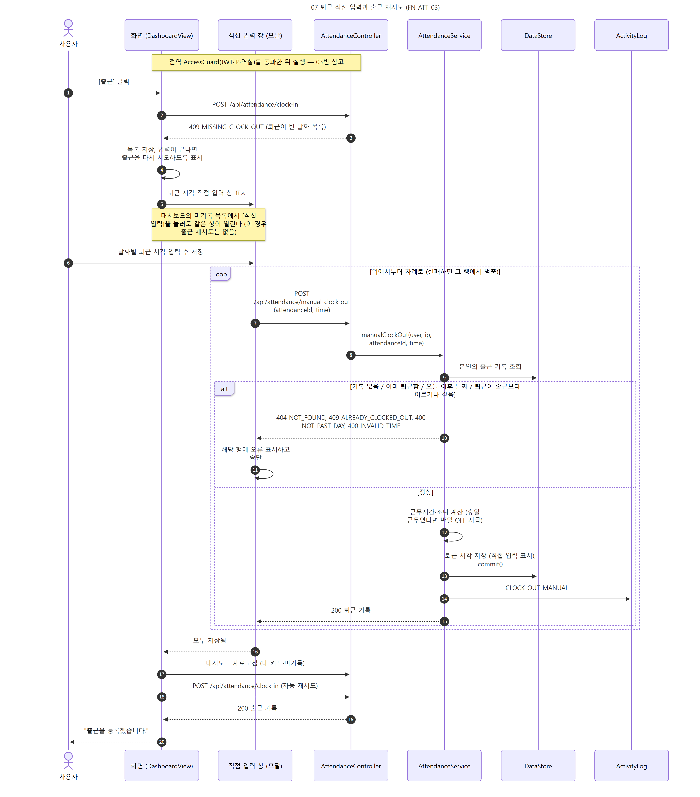

<details>
<summary>Mermaid 코드 보기</summary>

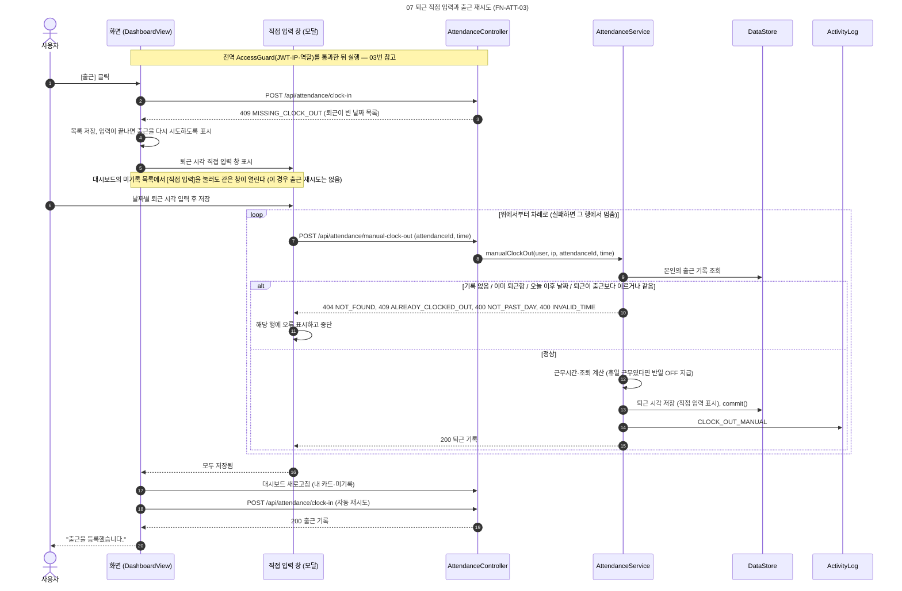

</details>

[↑ 목차](#목차)

<a id="seq-08"></a>

### 08. 월별 출퇴근 기록 조회

정산 화면에서 사람을 고르면 그 달의 일자별 출퇴근 기록을 보여줍니다. 팀원은 본인 기록만, 리드는 누구든 볼 수 있습니다.

- **요구사항**: 출퇴근 조회
- **API**: `GET /api/attendance?month&userId`
- **권한**: 본인 (리드는 팀원 지정 가능)
- **소스**: `backend/src/attendance/attendance.controller.ts`, `frontend/src/views/SettlementView.vue`

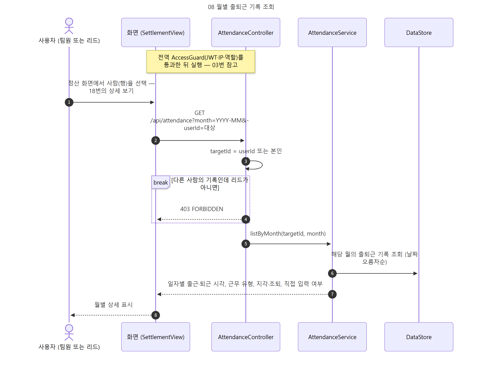

<details>
<summary>Mermaid 코드 보기</summary>

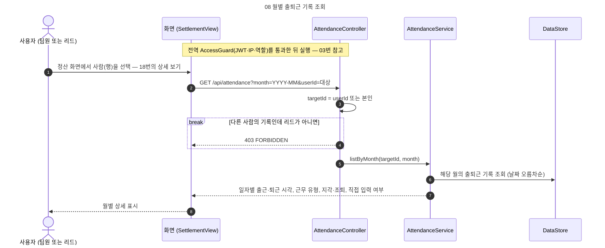

</details>

[↑ 목차](#목차)

## C. 대시보드

<a id="seq-09"></a>

### 09. 내 대시보드 카드

오늘의 출퇴근 기록, 오늘 대상인 내 신청, 공휴일 여부, 연차·재택·OFF 잔여를 한 번에 보여줍니다.

- **요구사항**: FN-DSH-02
- **API**: `GET /api/dashboard/me`
- **권한**: 로그인한 사용자 (전역 가드 통과)
- **소스**: `backend/src/dashboard/dashboard.service.ts`, `frontend/src/views/DashboardView.vue`

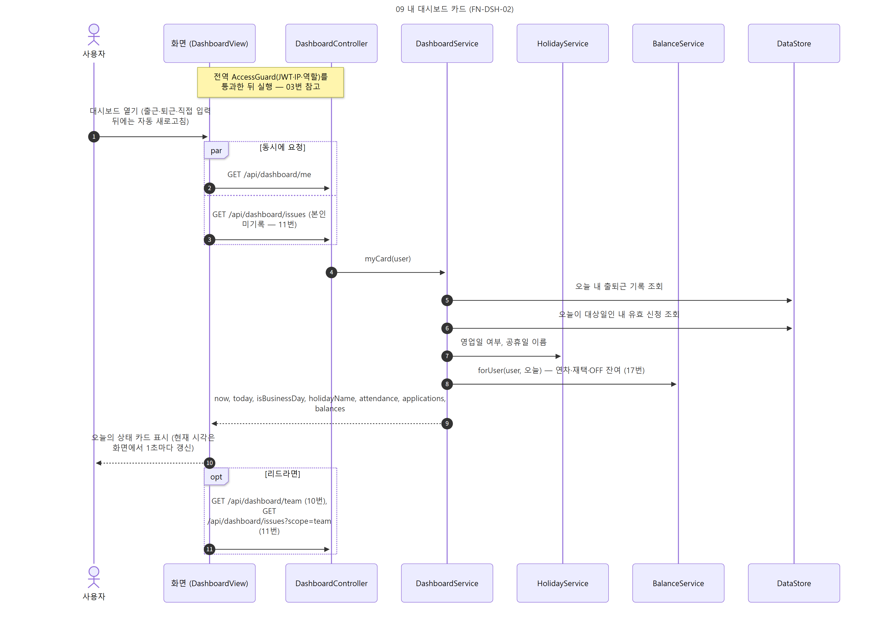

<details>
<summary>Mermaid 코드 보기</summary>

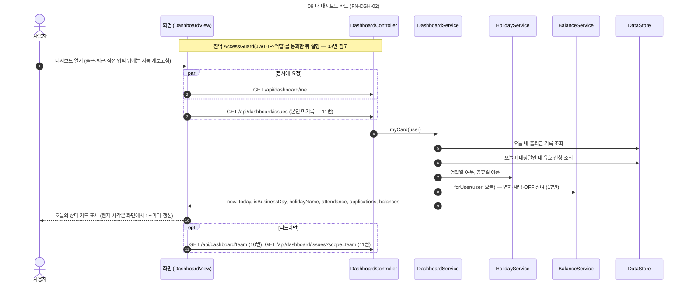

</details>

[↑ 목차](#목차)

<a id="seq-10"></a>

### 10. 팀 보드

오늘 팀원별 상태(근무 중, 퇴근, 연차, 반일 OFF, 재택, 주말근무 예정, 휴무일, 미출근)를 한눈에 보여줍니다.

- **요구사항**: FN-DSH-01
- **API**: `GET /api/dashboard/team`
- **권한**: 리드
- **소스**: `backend/src/dashboard/dashboard.service.ts`, `frontend/src/views/DashboardView.vue`

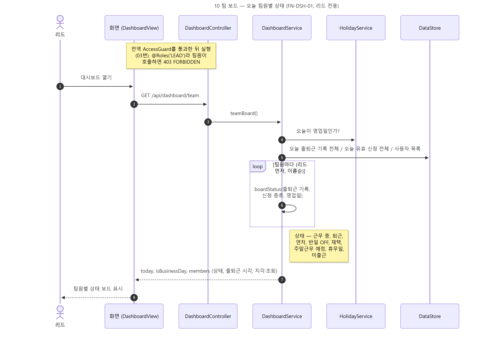

<details>
<summary>Mermaid 코드 보기</summary>

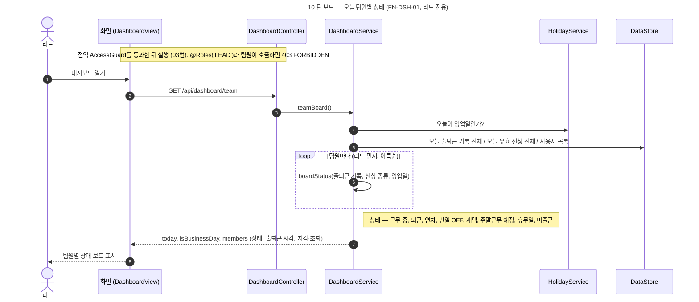

</details>

[↑ 목차](#목차)

<a id="seq-11"></a>

### 11. 미기록 건 조회

퇴근이 비어 있는 지난 날과 최근 30일 안에 퇴근을 직접 입력한 기록을 보여주고, 각 행에서 바로 직접 입력할 수 있습니다.

- **요구사항**: FN-DSH-03
- **API**: `GET /api/dashboard/issues`
- **권한**: 본인 (리드는 팀 전체 가능)
- **소스**: `backend/src/dashboard/dashboard.service.ts`, `backend/src/attendance/attendance.service.ts`

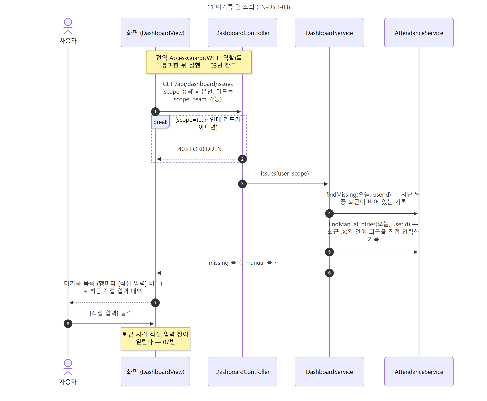

<details>
<summary>Mermaid 코드 보기</summary>

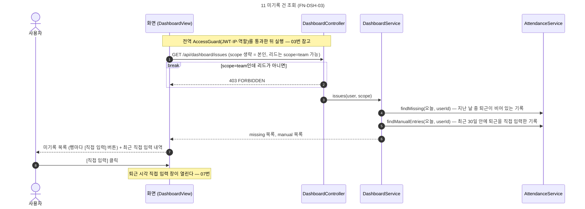

</details>

[↑ 목차](#목차)

## D. 신청 (연차·재택·OFF·주말근무)

<a id="seq-12"></a>

### 12. 신청서 제출

신청 기한(대상일의 전 영업일 17:00), 날짜 종류(영업일·휴일), 중복, 잔여 횟수(연차·재택 월 2회·OFF)를 차례로 검사하고 저장합니다. 검사와 저장 사이에 await가 없어 동시 신청이 끼어들 수 없습니다.

- **요구사항**: FN-REQ-01
- **API**: `POST /api/applications`
- **권한**: 로그인한 사용자 (전역 가드 통과)
- **소스**: `backend/src/applications/application.service.ts`, `backend/src/rules/application.rules.ts`, `frontend/src/views/ApplicationsView.vue`

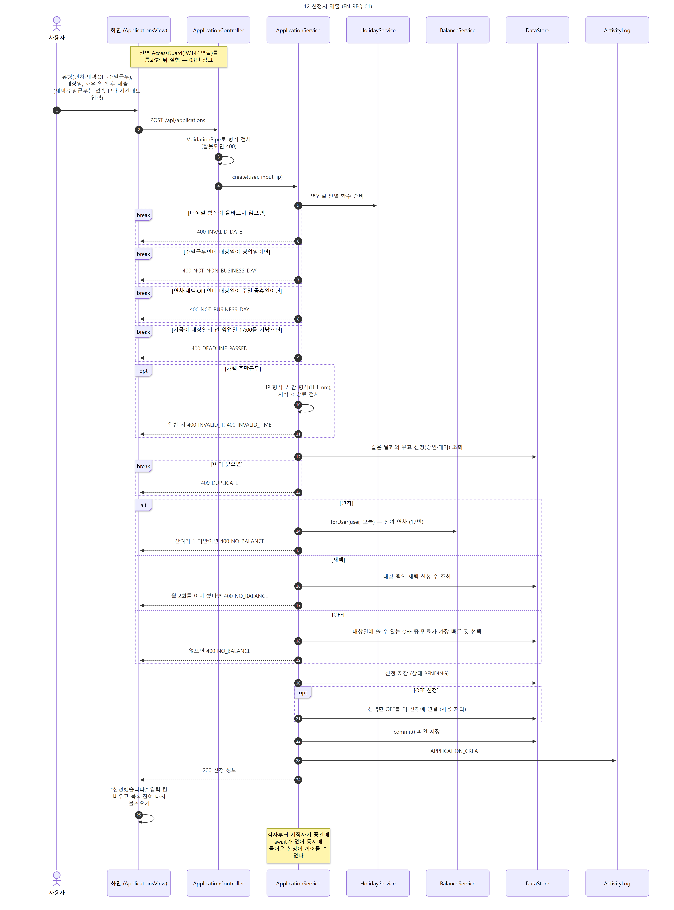

<details>
<summary>Mermaid 코드 보기</summary>

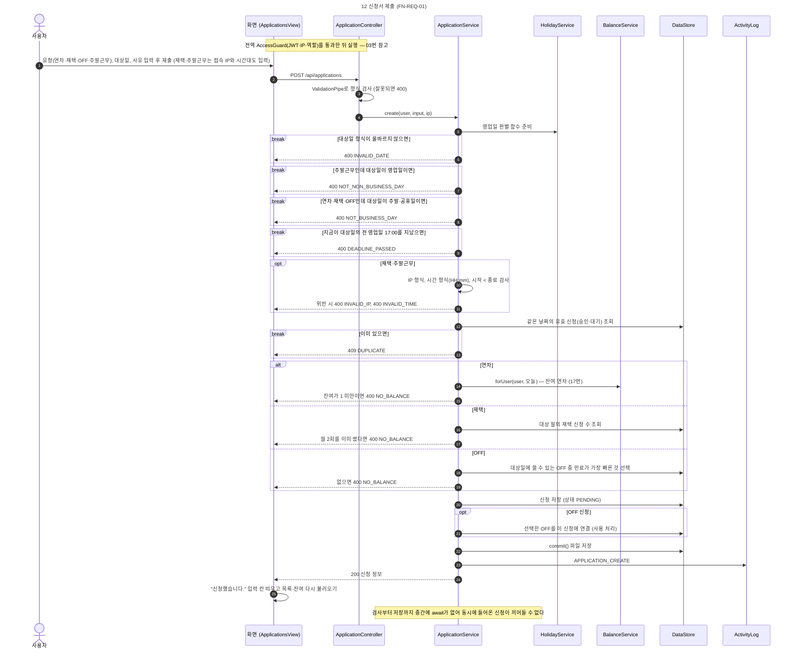

</details>

[↑ 목차](#목차)

<a id="seq-13"></a>

### 13. 신청 목록 조회

내 신청 또는 팀 전체 신청을 월·상태로 거릅니다. 각 신청마다 취소 가능 여부(`canCancel`)와 승인·반려 가능 여부(`canDecide`)를 서버가 계산해 내려줍니다.

- **요구사항**: 신청 조회
- **API**: `GET /api/applications`
- **권한**: 본인 (팀 신청은 리드)
- **소스**: `backend/src/applications/application.service.ts`, `frontend/src/views/ApplicationsView.vue`

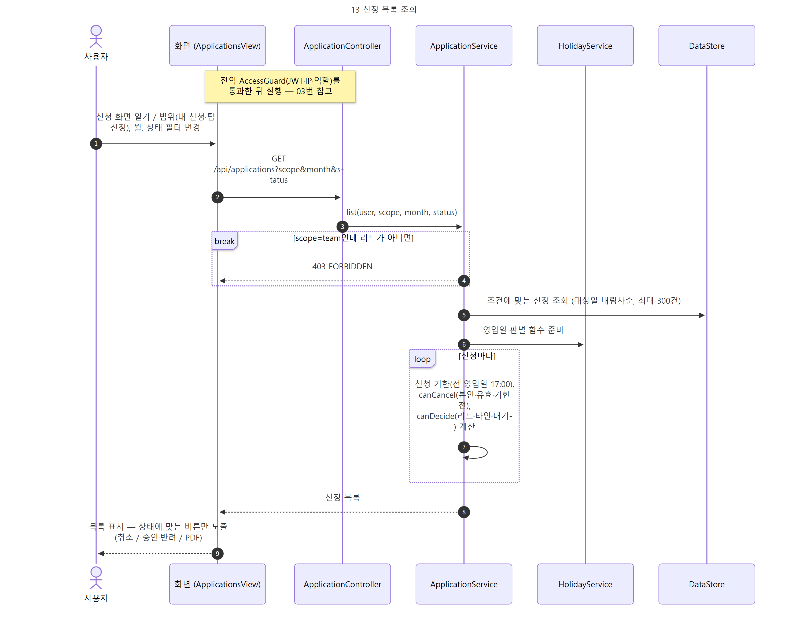

<details>
<summary>Mermaid 코드 보기</summary>

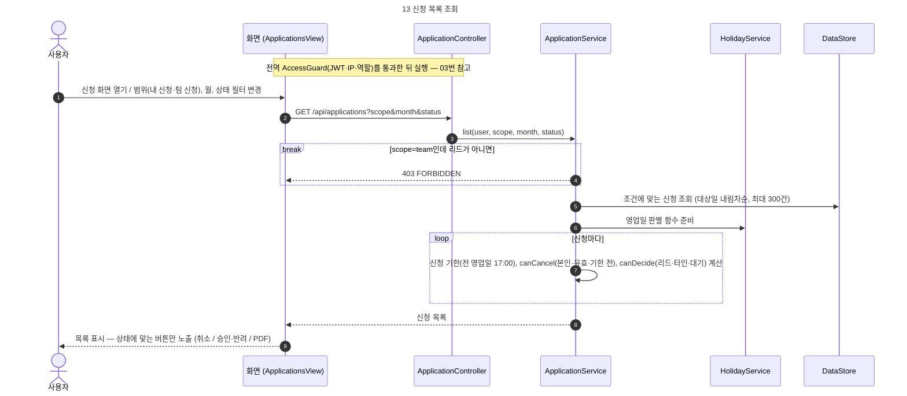

</details>

[↑ 목차](#목차)

<a id="seq-14"></a>

### 14. 신청 취소

신청 기한 전까지 본인이 취소할 수 있고, 확인 창을 거칩니다. 사용한 OFF가 있으면 돌려줍니다.

- **요구사항**: 신청 취소
- **API**: `POST /api/applications/:id/cancel`
- **권한**: 신청한 본인
- **소스**: `backend/src/applications/application.service.ts`, `frontend/src/components/ConfirmModal.vue`

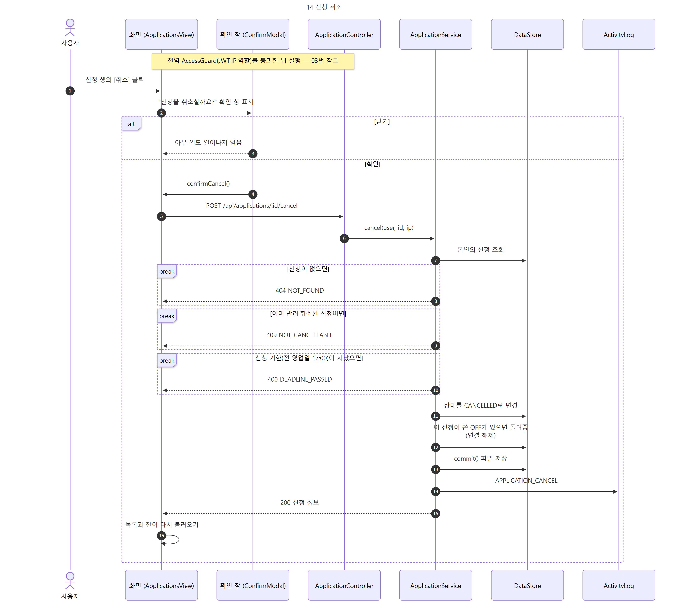

<details>
<summary>Mermaid 코드 보기</summary>

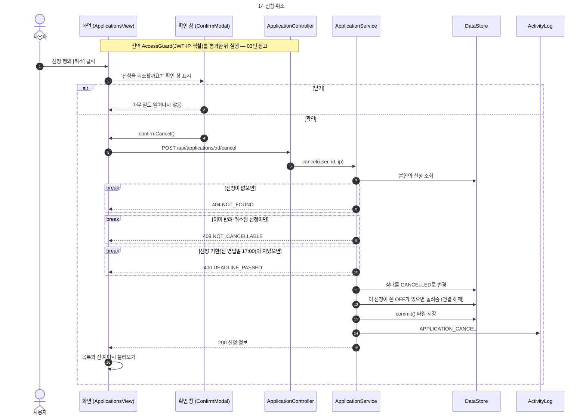

</details>

[↑ 목차](#목차)

<a id="seq-15"></a>

### 15. 신청 승인·반려

리드가 대기 중인 신청을 승인하거나 사유와 함께 반려합니다. 본인 신청은 처리할 수 없고, 반려하면 사용한 OFF를 돌려줍니다.

- **요구사항**: FN-REQ-02
- **API**: `POST /api/applications/:id/approve`, `.../reject`
- **권한**: 리드
- **소스**: `backend/src/applications/application.service.ts`, `backend/src/applications/application.controller.ts`

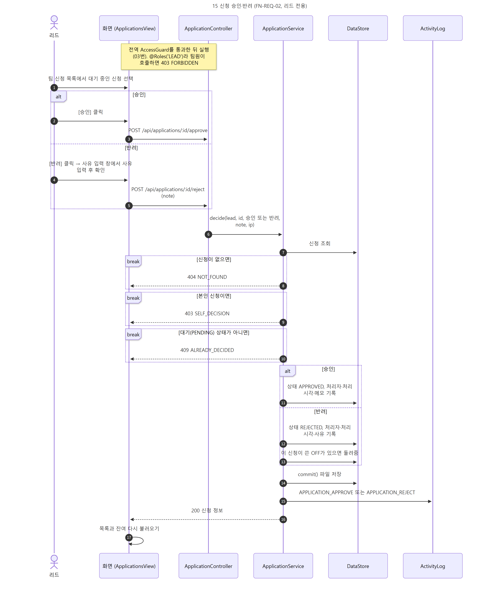

<details>
<summary>Mermaid 코드 보기</summary>

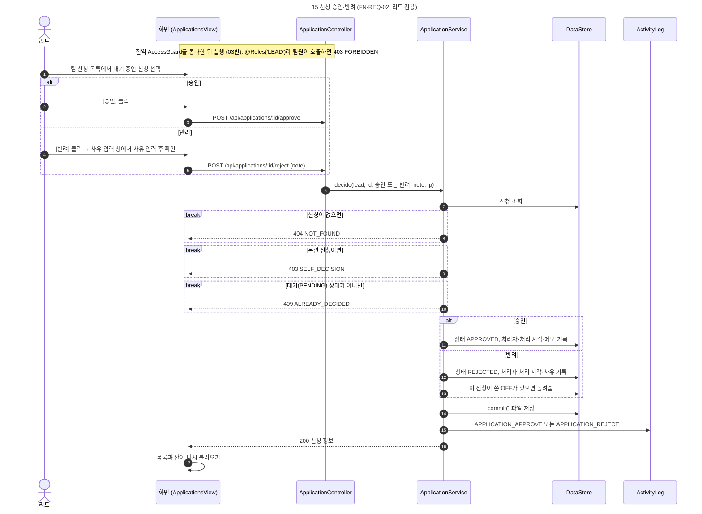

</details>

[↑ 목차](#목차)

<a id="seq-16"></a>

### 16. 신청서 PDF 다운로드

신청서를 PDF로 만들어 내려받습니다. 토큰이 필요한 파일이라 화면이 fetch로 받아 Blob 다운로드를 실행합니다.

- **요구사항**: FN-REQ-03
- **API**: `GET /api/applications/:id/pdf`
- **권한**: 신청한 본인 또는 리드
- **소스**: `backend/src/applications/application-pdf.service.ts`, `frontend/src/api/client.ts`

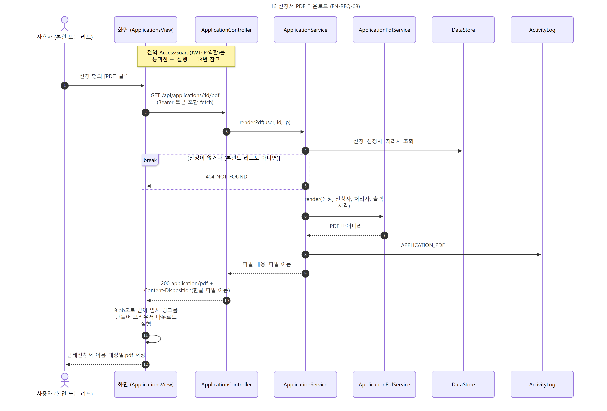

<details>
<summary>Mermaid 코드 보기</summary>

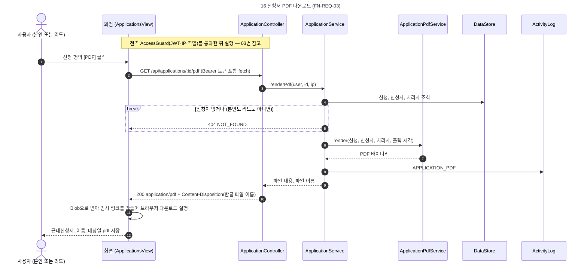

</details>

[↑ 목차](#목차)

<a id="seq-17"></a>

### 17. 내 연차·재택·OFF 잔여 조회

연차는 입사일 기준 매월 +1일 적립, 재택은 월 2회(이월 없음), OFF는 지급일부터 30일간 유효합니다. 같은 계산을 대시보드 카드와 월별 정산도 재사용합니다.

- **요구사항**: FN-BAL-01
- **API**: `GET /api/balances/me`
- **권한**: 로그인한 사용자 (전역 가드 통과)
- **소스**: `backend/src/core/balance.service.ts`, `backend/src/rules/balance.rules.ts`

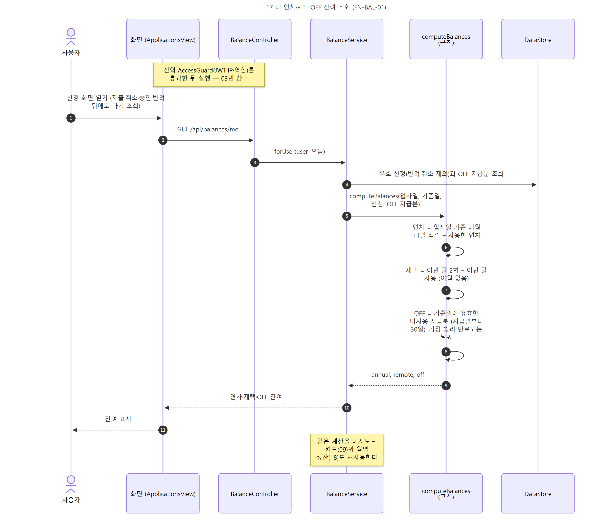

<details>
<summary>Mermaid 코드 보기</summary>

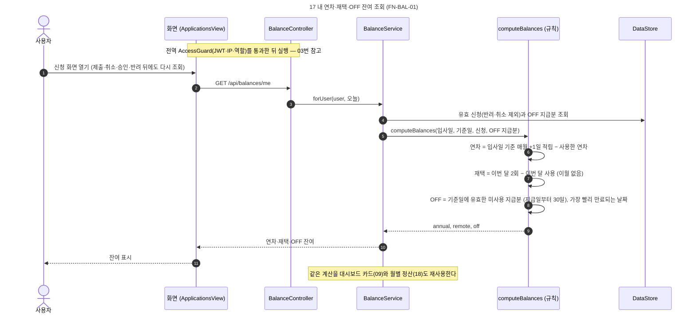

</details>

[↑ 목차](#목차)

## E. 정산·이력

<a id="seq-18"></a>

### 18. 월별 정산

월별 근무일·근무시간·지각·조퇴·직접 입력·퇴근 누락 건수와 기준일의 잔여를 집계합니다. 행을 누르면 일자별 상세(08번)를 보여줍니다.

- **요구사항**: FN-STL-01
- **API**: `GET /api/settlement?month=YYYY-MM`
- **권한**: 본인 행 (리드는 팀 전체)
- **소스**: `backend/src/settlement/settlement.service.ts`, `frontend/src/views/SettlementView.vue`

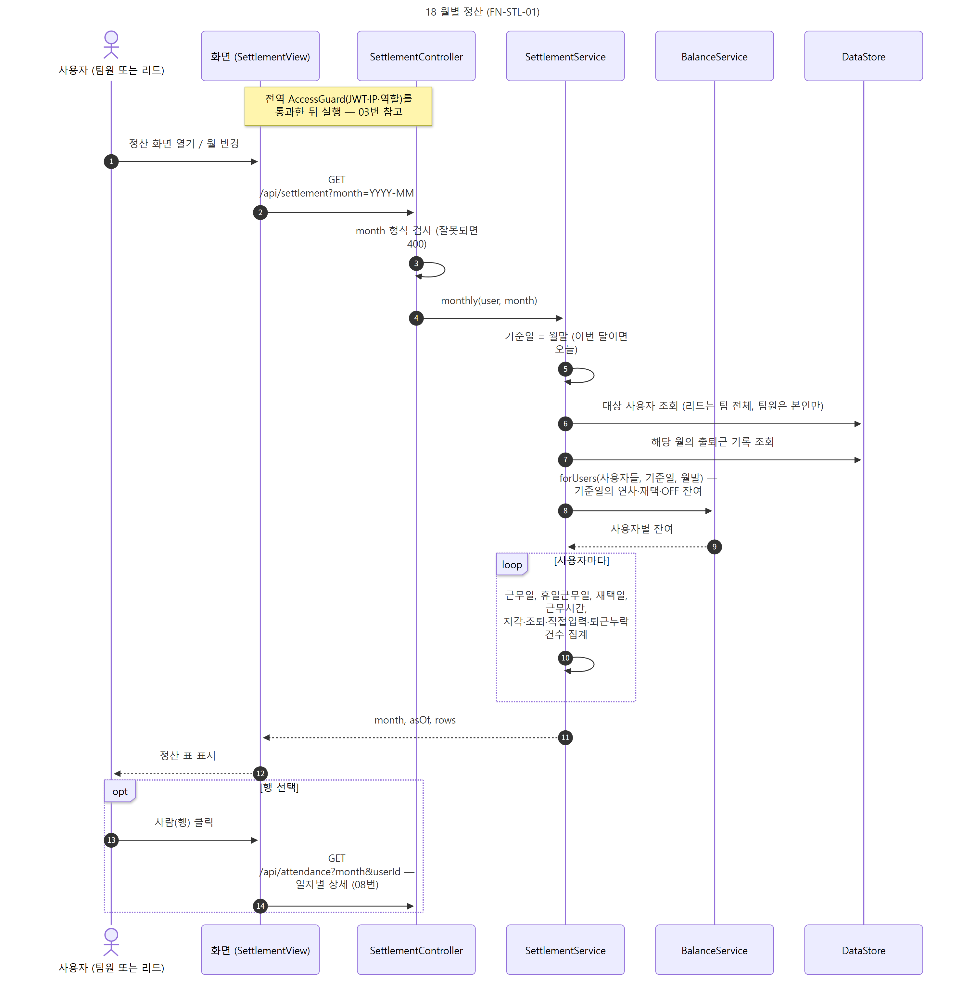

<details>
<summary>Mermaid 코드 보기</summary>

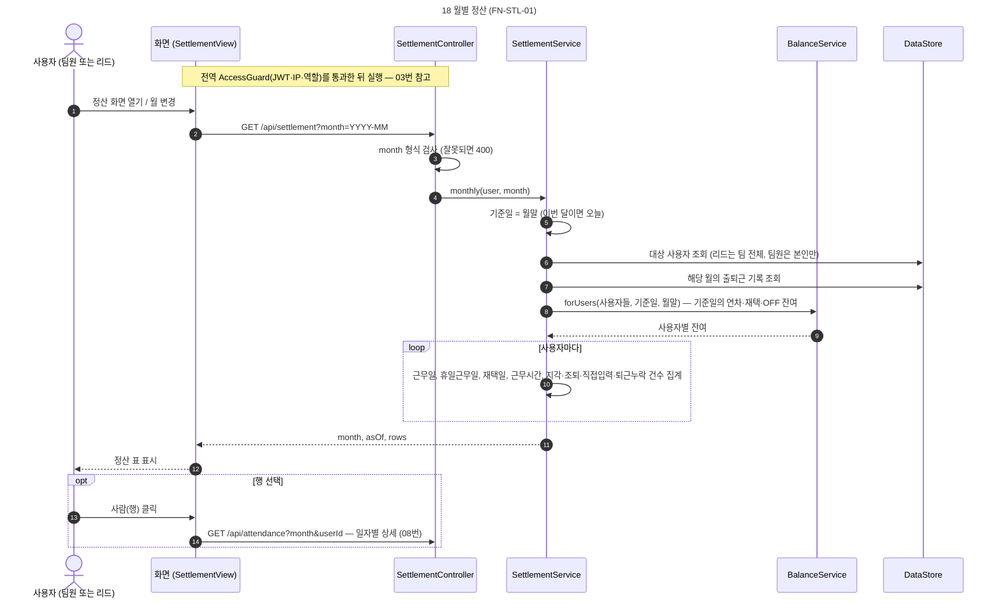

</details>

[↑ 목차](#목차)

<a id="seq-19"></a>

### 19. 이력 조회

접속·출퇴근·신청·설정 분류, 사용자, 기간으로 거르고 날짜별로 묶어 보여줍니다. "더 보기"는 마지막 id보다 오래된 이력을 이어서 가져옵니다.

- **요구사항**: FR-LOG-01
- **API**: `GET /api/logs`
- **권한**: 본인 이력 (리드는 전체)
- **소스**: `backend/src/logs/logs.service.ts`, `frontend/src/views/LogsView.vue`

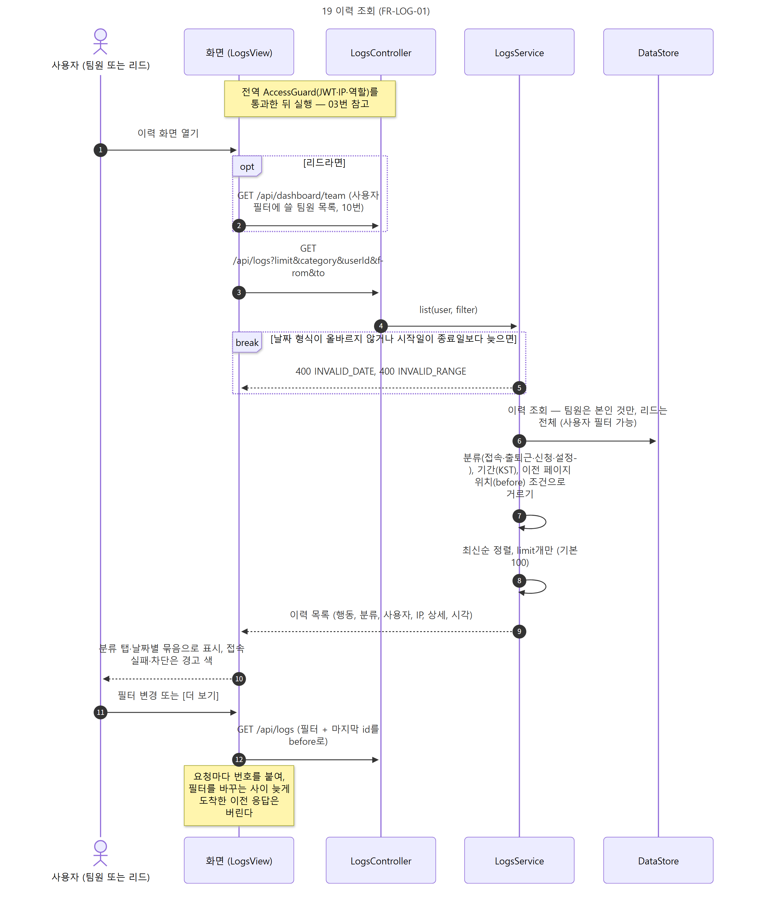

<details>
<summary>Mermaid 코드 보기</summary>

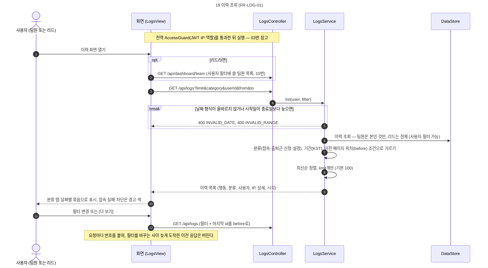

</details>

[↑ 목차](#목차)

## F. 리드 관리 (공휴일·접속 IP)

<a id="seq-20"></a>

### 20. 공휴일 조회

연도별 공휴일 목록을 보여줍니다. 공휴일은 코드로 계산하지 않고 데이터 파일에 저장하며, 신청 기한과 휴일 근무 판정에 쓰입니다.

- **요구사항**: 공휴일 관리
- **API**: `GET /api/holidays?year`
- **권한**: 로그인한 사용자 (화면은 리드 전용)
- **소스**: `backend/src/holidays/holiday-admin.service.ts`, `backend/src/core/holiday.service.ts`, `frontend/src/views/HolidaysView.vue`

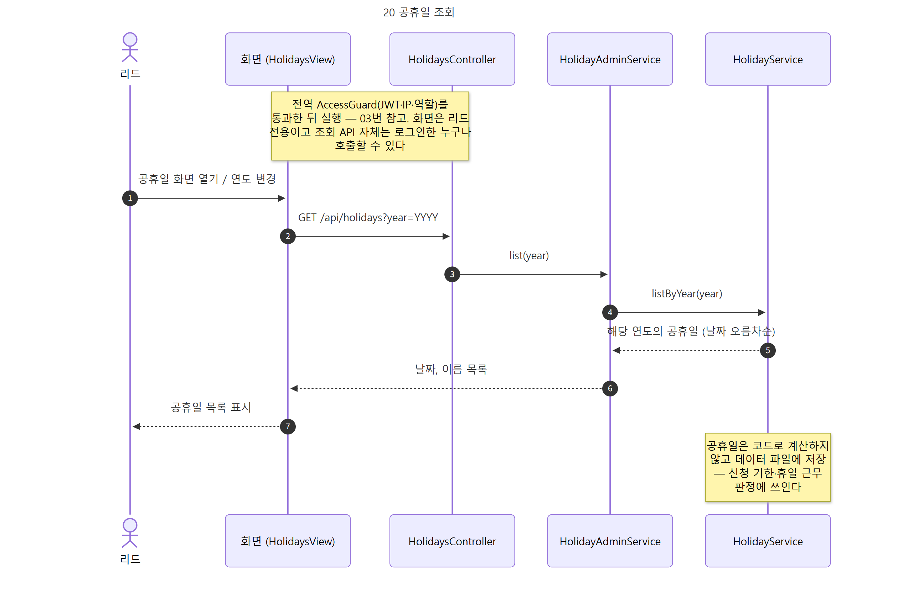

<details>
<summary>Mermaid 코드 보기</summary>

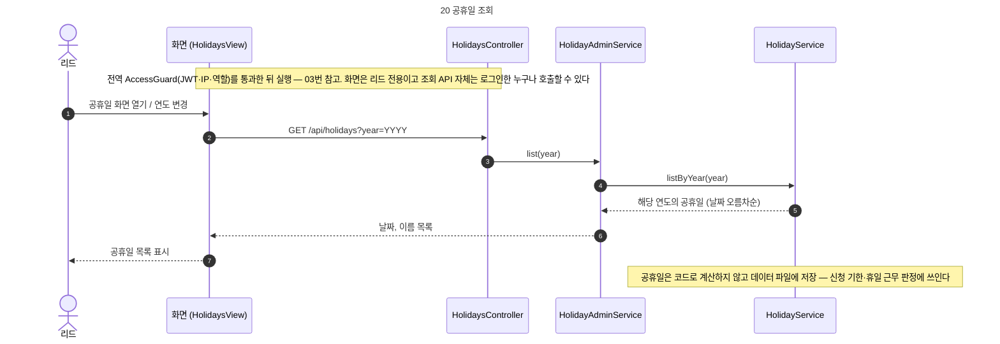

</details>

[↑ 목차](#목차)

<a id="seq-21"></a>

### 21. 공휴일 등록·삭제

리드가 공휴일을 등록(같은 날짜면 이름 수정)하거나 삭제합니다. 이미 기록된 판정이 소급해서 달라지지 않도록 오늘 이전 날짜는 바꿀 수 없습니다.

- **요구사항**: 공휴일 관리
- **API**: `POST /api/holidays`, `DELETE /api/holidays/:date`
- **권한**: 리드
- **소스**: `backend/src/holidays/holiday-admin.service.ts`, `frontend/src/views/HolidaysView.vue`

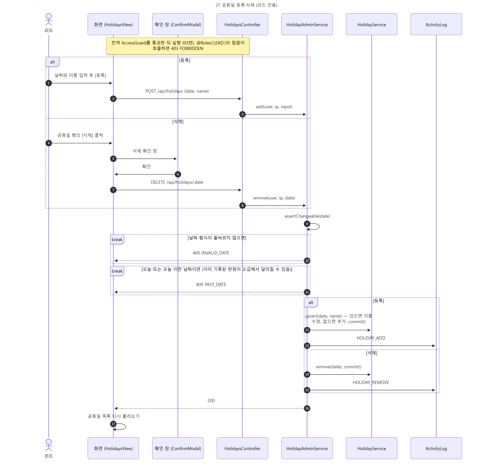

<details>
<summary>Mermaid 코드 보기</summary>

```mermaid
---
title: 21 공휴일 등록·삭제 (리드 전용)
---
sequenceDiagram
    autonumber
    actor U as 리드
    participant V as 화면 (HolidaysView)
    participant C as 확인 창 (ConfirmModal)
    participant A as HolidaysController
    participant S as HolidayAdminService
    participant H as HolidayService
    participant L as ActivityLog

    Note over V,A: 전역 AccessGuard를 통과한 뒤 실행 (03번). @Roles('LEAD')라 팀원이 호출하면 403 FORBIDDEN
    alt 등록
        U->>V: 날짜와 이름 입력 후 [등록]
        V->>A: POST /api/holidays (date, name)
        A->>S: add(user, ip, input)
    else 삭제
        U->>V: 공휴일 행의 [삭제] 클릭
        V->>C: 삭제 확인 창
        C->>V: 확인
        V->>A: DELETE /api/holidays/:date
        A->>S: remove(user, ip, date)
    end
    S->>S: assertChangeable(date)
    break 날짜 형식이 올바르지 않으면
        S-->>V: 400 INVALID_DATE
    end
    break 오늘 또는 오늘 이전 날짜이면 (이미 기록된 판정이 소급해서 달라질 수 있음)
        S-->>V: 400 PAST_DATE
    end
    alt 등록
        S->>H: upsert(date, name) — 있으면 이름 수정, 없으면 추가, commit()
        S->>L: HOLIDAY_ADD
    else 삭제
        S->>H: remove(date), commit()
        S->>L: HOLIDAY_REMOVE
    end
    S-->>V: 200
    V->>V: 공휴일 목록 다시 불러오기
```

</details>

[↑ 목차](#목차)

<a id="seq-22"></a>

### 22. 연구실 접속 IP 목록 조회

등록된 연구실 IP를 보여주고 지금 접속 중인 IP에 표시를 붙입니다.

- **요구사항**: IP 관리
- **API**: `GET /api/allowed-ips`
- **권한**: 리드
- **소스**: `backend/src/allowed-ips/allowed-ips.service.ts`, `frontend/src/views/AllowedIpsView.vue`

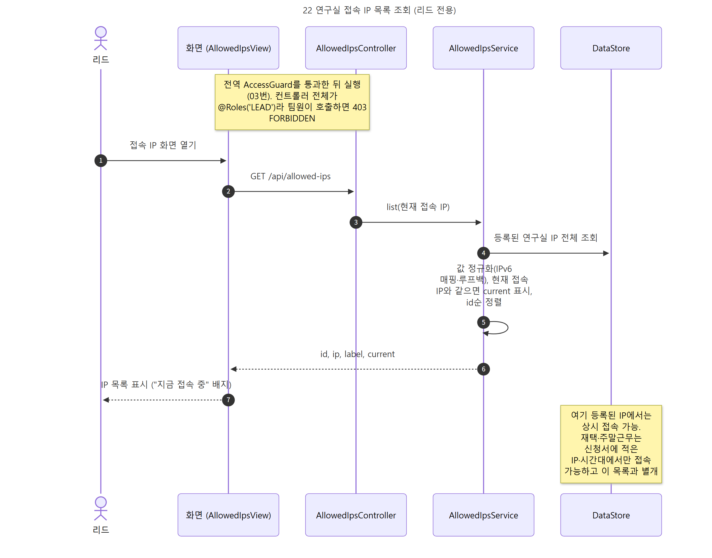

<details>
<summary>Mermaid 코드 보기</summary>

```mermaid
---
title: 22 연구실 접속 IP 목록 조회 (리드 전용)
---
sequenceDiagram
    autonumber
    actor U as 리드
    participant V as 화면 (AllowedIpsView)
    participant A as AllowedIpsController
    participant S as AllowedIpsService
    participant D as DataStore

    Note over V,A: 전역 AccessGuard를 통과한 뒤 실행 (03번). 컨트롤러 전체가 @Roles('LEAD')라 팀원이 호출하면 403 FORBIDDEN
    U->>V: 접속 IP 화면 열기
    V->>A: GET /api/allowed-ips
    A->>S: list(현재 접속 IP)
    S->>D: 등록된 연구실 IP 전체 조회
    S->>S: 값 정규화(IPv6 매핑·루프백), 현재 접속 IP와 같으면 current 표시, id순 정렬
    S-->>V: id, ip, label, current
    V-->>U: IP 목록 표시 ("지금 접속 중" 배지)
    Note over D: 여기 등록된 IP에서는 상시 접속 가능. 재택·주말근무는 신청서에 적은 IP·시간대에서만 접속 가능하고 이 목록과 별개
```

</details>

[↑ 목차](#목차)

<a id="seq-23"></a>

### 23. 연구실 접속 IP 등록

IP 형식을 검사하고(IPv6 매핑·루프백은 정규화) 중복이면 거절합니다.

- **요구사항**: IP 관리
- **API**: `POST /api/allowed-ips`
- **권한**: 리드
- **소스**: `backend/src/allowed-ips/allowed-ips.service.ts`

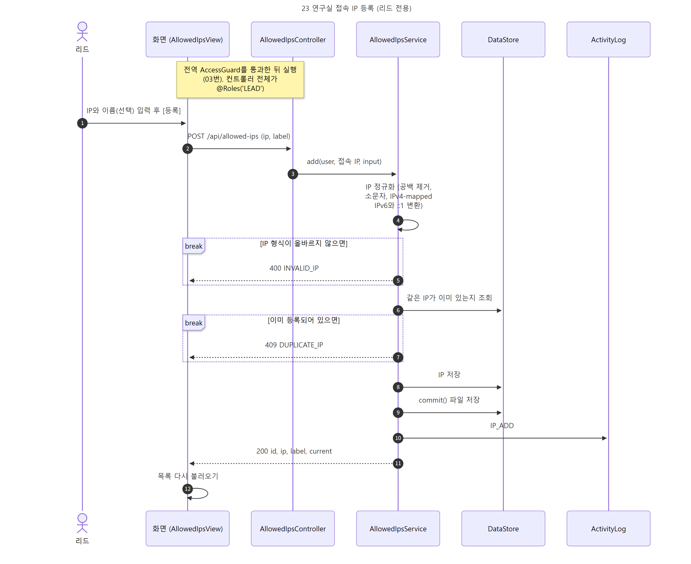

<details>
<summary>Mermaid 코드 보기</summary>

```mermaid
---
title: 23 연구실 접속 IP 등록 (리드 전용)
---
sequenceDiagram
    autonumber
    actor U as 리드
    participant V as 화면 (AllowedIpsView)
    participant A as AllowedIpsController
    participant S as AllowedIpsService
    participant D as DataStore
    participant L as ActivityLog

    Note over V,A: 전역 AccessGuard를 통과한 뒤 실행 (03번). 컨트롤러 전체가 @Roles('LEAD')
    U->>V: IP와 이름(선택) 입력 후 [등록]
    V->>A: POST /api/allowed-ips (ip, label)
    A->>S: add(user, 접속 IP, input)
    S->>S: IP 정규화 (공백 제거, 소문자, IPv4-mapped IPv6와 ::1 변환)
    break IP 형식이 올바르지 않으면
        S-->>V: 400 INVALID_IP
    end
    S->>D: 같은 IP가 이미 있는지 조회
    break 이미 등록되어 있으면
        S-->>V: 409 DUPLICATE_IP
    end
    S->>D: IP 저장
    S->>D: commit() 파일 저장
    S->>L: IP_ADD
    S-->>V: 200 id, ip, label, current
    V->>V: 목록 다시 불러오기
```

</details>

[↑ 목차](#목차)

<a id="seq-24"></a>

### 24. 연구실 접속 IP 이름 수정

IP 값은 그대로 두고 이름(라벨)만 바꿉니다.

- **요구사항**: IP 관리
- **API**: `PATCH /api/allowed-ips/:id`
- **권한**: 리드
- **소스**: `backend/src/allowed-ips/allowed-ips.service.ts`, `frontend/src/views/AllowedIpsView.vue`

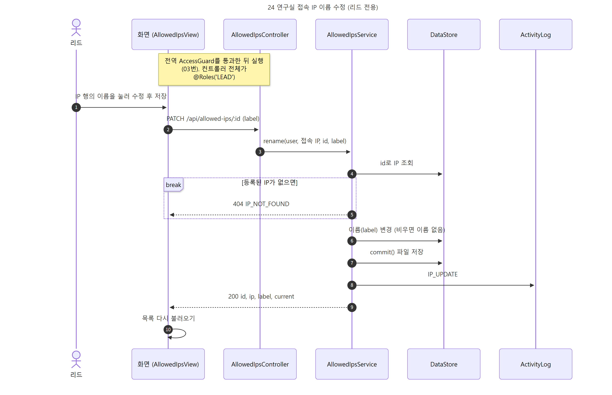

<details>
<summary>Mermaid 코드 보기</summary>

```mermaid
---
title: 24 연구실 접속 IP 이름 수정 (리드 전용)
---
sequenceDiagram
    autonumber
    actor U as 리드
    participant V as 화면 (AllowedIpsView)
    participant A as AllowedIpsController
    participant S as AllowedIpsService
    participant D as DataStore
    participant L as ActivityLog

    Note over V,A: 전역 AccessGuard를 통과한 뒤 실행 (03번). 컨트롤러 전체가 @Roles('LEAD')
    U->>V: IP 행의 이름을 눌러 수정 후 저장
    V->>A: PATCH /api/allowed-ips/:id (label)
    A->>S: rename(user, 접속 IP, id, label)
    S->>D: id로 IP 조회
    break 등록된 IP가 없으면
        S-->>V: 404 IP_NOT_FOUND
    end
    S->>D: 이름(label) 변경 (비우면 이름 없음)
    S->>D: commit() 파일 저장
    S->>L: IP_UPDATE
    S-->>V: 200 id, ip, label, current
    V->>V: 목록 다시 불러오기
```

</details>

[↑ 목차](#목차)

<a id="seq-25"></a>

### 25. 연구실 접속 IP 삭제

마지막 하나는 지울 수 없고(모두가 접속을 잃음), 지금 접속 중인 IP도 지울 수 없습니다(본인이 접속을 잃음).

- **요구사항**: IP 관리
- **API**: `DELETE /api/allowed-ips/:id`
- **권한**: 리드
- **소스**: `backend/src/allowed-ips/allowed-ips.service.ts`, `frontend/src/components/ConfirmModal.vue`

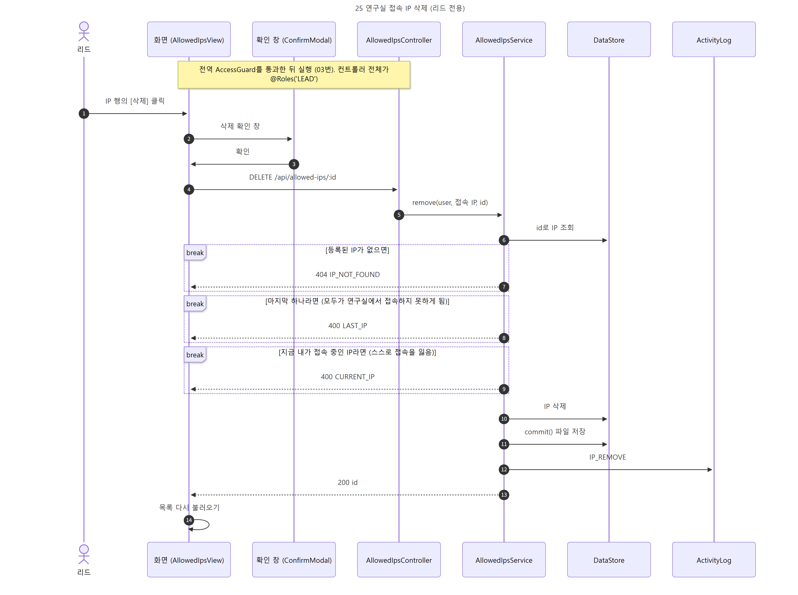

<details>
<summary>Mermaid 코드 보기</summary>

```mermaid
---
title: 25 연구실 접속 IP 삭제 (리드 전용)
---
sequenceDiagram
    autonumber
    actor U as 리드
    participant V as 화면 (AllowedIpsView)
    participant C as 확인 창 (ConfirmModal)
    participant A as AllowedIpsController
    participant S as AllowedIpsService
    participant D as DataStore
    participant L as ActivityLog

    Note over V,A: 전역 AccessGuard를 통과한 뒤 실행 (03번). 컨트롤러 전체가 @Roles('LEAD')
    U->>V: IP 행의 [삭제] 클릭
    V->>C: 삭제 확인 창
    C->>V: 확인
    V->>A: DELETE /api/allowed-ips/:id
    A->>S: remove(user, 접속 IP, id)
    S->>D: id로 IP 조회
    break 등록된 IP가 없으면
        S-->>V: 404 IP_NOT_FOUND
    end
    break 마지막 하나라면 (모두가 연구실에서 접속하지 못하게 됨)
        S-->>V: 400 LAST_IP
    end
    break 지금 내가 접속 중인 IP라면 (스스로 접속을 잃음)
        S-->>V: 400 CURRENT_IP
    end
    S->>D: IP 삭제
    S->>D: commit() 파일 저장
    S->>L: IP_REMOVE
    S-->>V: 200 id
    V->>V: 목록 다시 불러오기
```

</details>

[↑ 목차](#목차)

## G. 공통·운영

<a id="seq-26"></a>

### 26. 데이터 저장과 이력 기록

변경은 메모리에 먼저 반영하고 `commit()`으로 파일에 저장합니다. 업무 데이터(`db.json`)는 임시 파일에 쓴 뒤 이름을 바꿔 교체하고, 이력(`activity-log.jsonl`)은 새 줄만 덧붙입니다. 이력 저장 실패는 본 업무를 막지 않습니다.

- **요구사항**: 데이터 저장 (공통)
- **API**: 모든 쓰기 기능 내부
- **권한**: —
- **소스**: `backend/src/store/data-store.ts`, `backend/src/core/activity-log.service.ts`

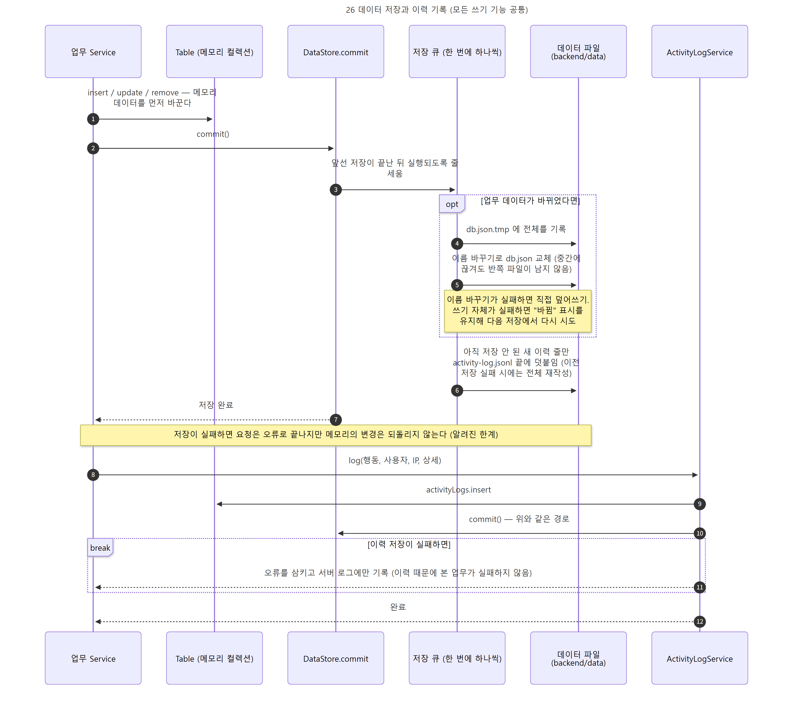

<details>
<summary>Mermaid 코드 보기</summary>

```mermaid
---
title: 26 데이터 저장과 이력 기록 (모든 쓰기 기능 공통)
---
sequenceDiagram
    autonumber
    participant S as 업무 Service
    participant T as Table (메모리 컬렉션)
    participant C as DataStore.commit
    participant Q as 저장 큐 (한 번에 하나씩)
    participant F as 데이터 파일 (backend/data)
    participant L as ActivityLogService

    S->>T: insert / update / remove — 메모리 데이터를 먼저 바꾼다
    S->>C: commit()
    C->>Q: 앞선 저장이 끝난 뒤 실행되도록 줄 세움
    opt 업무 데이터가 바뀌었다면
        Q->>F: db.json.tmp 에 전체를 기록
        Q->>F: 이름 바꾸기로 db.json 교체 (중간에 끊겨도 반쪽 파일이 남지 않음)
        Note over Q,F: 이름 바꾸기가 실패하면 직접 덮어쓰기. 쓰기 자체가 실패하면 "바뀜" 표시를 유지해 다음 저장에서 다시 시도
    end
    Q->>F: 아직 저장 안 된 새 이력 줄만 activity-log.jsonl 끝에 덧붙임 (이전 저장 실패 시에는 전체 재작성)
    C-->>S: 저장 완료
    Note over S,F: 저장이 실패하면 요청은 오류로 끝나지만 메모리의 변경은 되돌리지 않는다 (알려진 한계)
    S->>L: log(행동, 사용자, IP, 상세)
    L->>T: activityLogs.insert
    L->>C: commit() — 위와 같은 경로
    break 이력 저장이 실패하면
        L-->>S: 오류를 삼키고 서버 로그에만 기록 (이력 때문에 본 업무가 실패하지 않음)
    end
    L-->>S: 완료
```

</details>

[↑ 목차](#목차)

<a id="seq-27"></a>

### 27. 서버 상태 확인

토큰 없이 서버가 살아 있는지 확인합니다.

- **요구사항**: 운영
- **API**: `GET /api/health`
- **권한**: 누구나 (공개 API)
- **소스**: `backend/src/health.controller.ts`

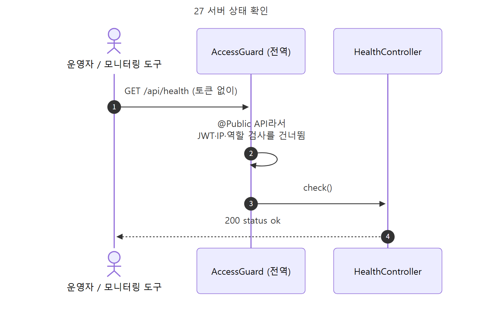

<details>
<summary>Mermaid 코드 보기</summary>

```mermaid
---
title: 27 서버 상태 확인
---
sequenceDiagram
    autonumber
    actor M as 운영자 / 모니터링 도구
    participant G as AccessGuard (전역)
    participant H as HealthController

    M->>G: GET /api/health (토큰 없이)
    G->>G: @Public API라서 JWT·IP·역할 검사를 건너뜀
    G->>H: check()
    H-->>M: 200 status ok
```

</details>

[↑ 목차](#목차)

---

## 다이어그램 다시 만들기

원본은 [`sequence/`](sequence) 폴더의 `.mmd` 파일(Mermaid 코드)이고, 같은 이름의 `.png`가 렌더링 결과입니다. 코드를 고친 뒤 이미지를 다시 만들려면 [mermaid-cli](https://github.com/mermaid-js/mermaid-cli)를 사용합니다. 설정(`mermaid.config.json`)에 한글 글꼴과 간격이 들어 있습니다.

```bash
# 저장소 루트에서 한 장 만들기
npx -p @mermaid-js/mermaid-cli mmdc -i docs/sequence/01-login.mmd -o docs/sequence/01-login.png \
  -c docs/sequence/mermaid.config.json -s 2 -b white

# 전체 다시 만들기 (bash)
for f in docs/sequence/*.mmd; do
  npx -p @mermaid-js/mermaid-cli mmdc -i "$f" -o "${f%.mmd}.png" -c docs/sequence/mermaid.config.json -s 2 -b white
done
```

- 처음 실행하면 mermaid-cli가 헤드리스 브라우저(Chromium)를 내려받습니다. 이미 설치된 Chrome을 쓰려면 `-p puppeteer.json`에 `{"executablePath": "<chrome 경로>", "headless": true}`를 적어 넘기세요.
- 이미지 없이 보려면 위 `<details>` 안의 코드를 [mermaid.live](https://mermaid.live)에 붙여 넣거나, GitHub에서 이 문서를 열면 코드 블록이 그대로 그려집니다.
